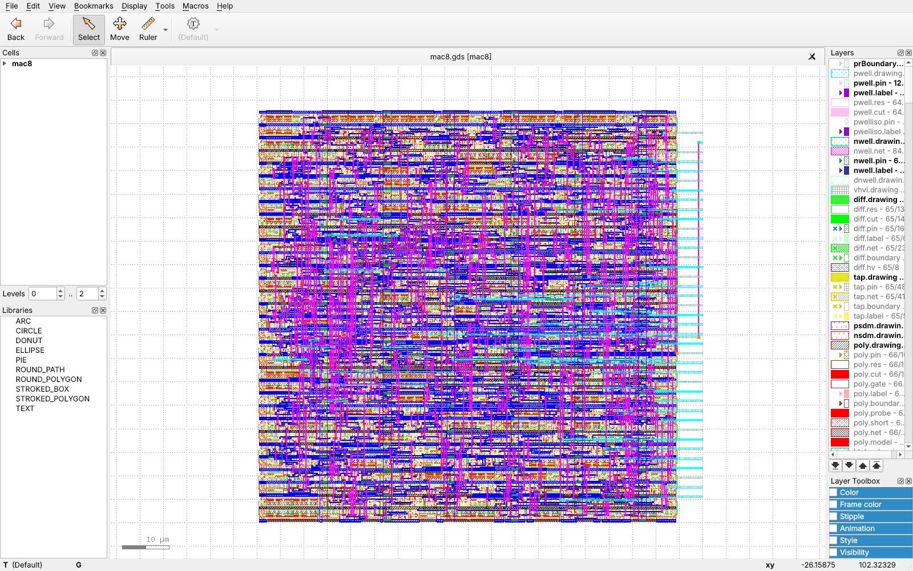
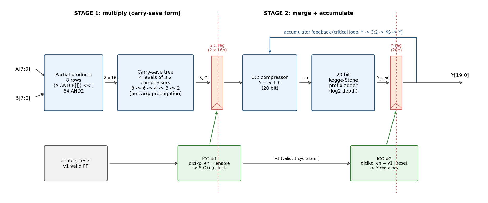
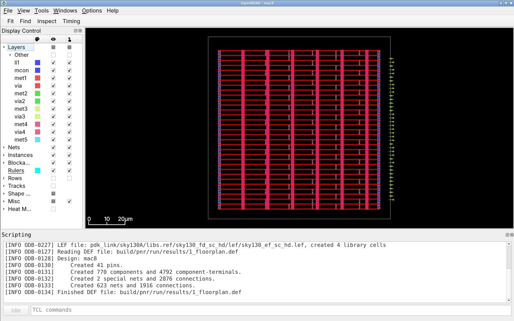
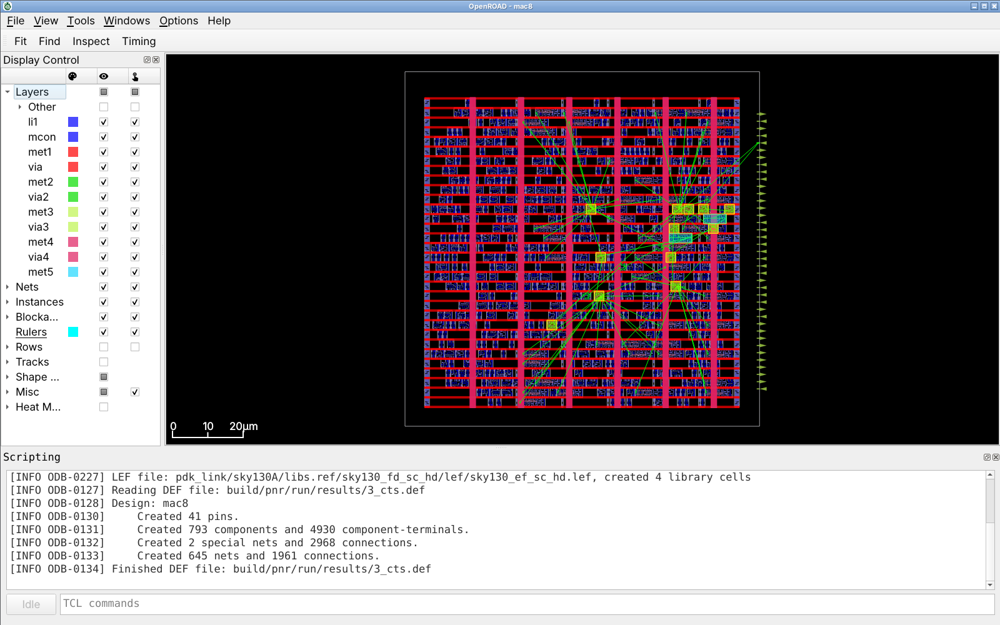
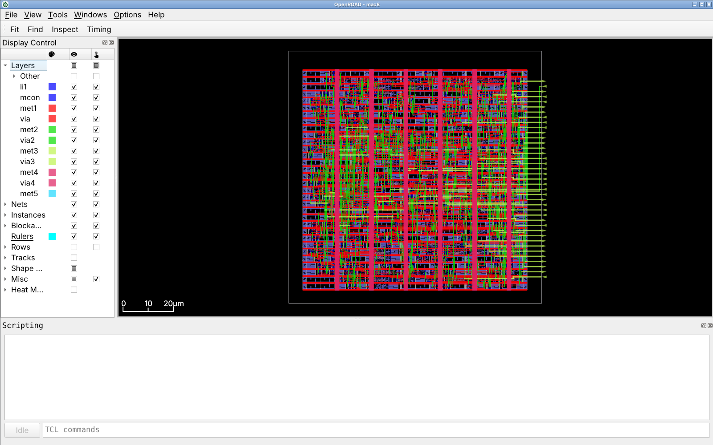
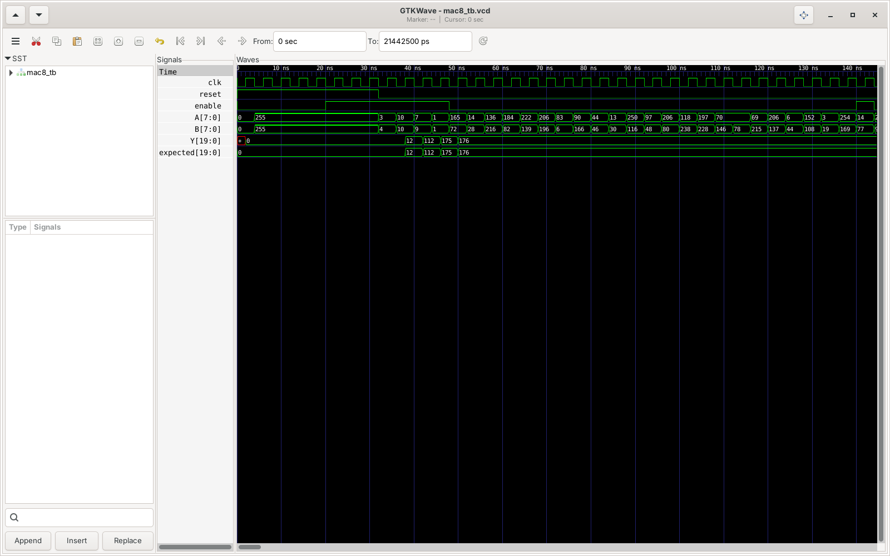

# mac8: an 8-bit MAC unit from RTL to GDSII on SKY130

A synchronous 8-bit multiply-accumulate (MAC) unit taken through the complete digital ASIC flow, from Verilog RTL to a
DRC- and LVS-clean GDSII layout, on the open-source [SkyWater SKY130](https://github.com/google/skywater-pdk) process
using only open-source tools: Yosys, OpenROAD/OpenSTA, Magic, Netgen and Icarus Verilog.

```
Y(n+1) = Y(n) + A(n) * B(n)      A, B: unsigned 8-bit   Y: 20-bit accumulator
synchronous active-high reset, enable = 1 accumulates, enable = 0 holds
```

The baseline design misses the 250 MHz target. The final design is a 2-stage pipeline with a carry-save multiplier,
a Kogge-Stone accumulator adder and clock gating. It runs at **304 MHz** after routing, at one MAC per clock cycle.



## Results

Typical corner (tt, 25 °C, 1.8 V), 4 ns clock (250 MHz).

| Metric | Baseline (synthesis) | Final (after place and route) | Target |
|---|---|---|---|
| Area | 4,449 µm² of cells | 10,000 µm² die, 4,318 µm² of cells | ≤ 10,000 µm² |
| Minimum clock period | 6.63 ns | 3.28 ns | ≤ 4 ns |
| Maximum frequency | 151 MHz | 304 MHz | ≥ 250 MHz |
| Setup / hold slack | -2.63 / +0.31 ns | +0.716 / +0.053 ns | ≥ 0 |
| Power at 250 MHz | 1.73 mW | 1.76 mW typical, 2.01 mW worst case | ≤ 2 mW |
| DRC / LVS | – | 0 violations / circuits match | 0 / match |

Power is measured with the switching activity of every net taken from gate-level simulation, plus extracted wire
parasitics. "Typical" means 75% of cycles do a MAC; "worst case" means a MAC with random operands on every cycle.

Compared with the baseline, the final design gives **2.02× the throughput** for 17% more
synthesized area, so throughput per unit area improves 1.72×. Energy per MAC is about the same (~7 pJ).

## Architecture



1. **Stage 1 (multiply):** eight partial-product rows are reduced by four levels of 3:2 carry-save compressors.
   The product is kept as two vectors, sum and carry, so the multiplier never needs its own carry-propagate adder.
2. **Stage 2 (accumulate):** Y + sum + carry is merged with one more 3:2 level and a single 20-bit Kogge-Stone
   prefix adder. This accumulator loop is the critical path, and it can't be pipelined.
3. **Clock gating:** the product registers and the accumulator are clocked through SKY130 integrated clock gates,
   so idle registers see no clock edges.
4. **Reset** clears Y and drops any operation still in the pipeline. The output is the specified behaviour,
   delayed by one cycle.

### How the design got there

All configurations synthesized with the same library and constraints:

| Configuration | Area (µm²) | Setup slack (ns) | Fmax (MHz) | Power (mW) |
|---|---|---|---|---|
| Baseline: 1 stage, inferred `*` and `+` | 4,449 | -2.632 | 151 | 1.73 |
| 2 stages, inferred `*` and `+` | 4,882 | -1.400 | 185 | 1.56 |
| 2 stages, carry-save + Kogge-Stone | 5,539 | +0.465 | 283 | 1.82 |
| 3 stages, carry-save + Kogge-Stone | 6,848 | +0.465 | 283 | 2.30 |
| 2 stages + clock gating | 5,001 | -0.063 | 246 | 1.67 |
| **Final**: + delay-oriented synthesis | 5,211 | -0.004 | 250 | 1.68 |

- Pipelining alone wasn't enough: Fmax only rose to 185 MHz, because the critical path moved into the accumulator loop, which still held a 20-bit ripple adder.
- The carry-save datapath fixed timing. A third stage added area and power with no frequency gain, because the loop sets the clock.
- Clock gating removed the hold multiplexers, cutting area and power.
- A delay-oriented synthesis script stopped the synthesis tool from turning the Kogge-Stone adder back into a ripple chain.

The setup slack above is from synthesis estimates. After place and route the final design meets timing with +0.716 ns.

## Repository layout

```
rtl/mac8.v                  the design (parameters STAGES, FAST_ARITH, CLK_GATE; defaults = final design)
tb/mac8_tb.v                self-checking testbench, prints RESULT: PASS or FAIL
tb/sky130_icg_model.v       clock-gate cell model for gate-level simulation
constraints/constraints.sdc 250 MHz timing constraints
config/                     OpenROAD place-and-route flow, Magic (GDS, DRC, min-area fix, extraction), Netgen LVS
scripts/                    synthesis, timing and power, gate-level simulation, sign-off, report and screenshot scripts
run_all.sh                  runs the whole flow into build/
verify.sh                   PASS/FAIL for every check, compared with the reference results
reports/ layout/ verification/ results/   reference results (reports, GDS, DRC/LVS, screenshots)
report.pdf                  7-page technical report
```

## Running it

Everything runs inside the [IIC-OSIC-TOOLS](https://github.com/iic-jku/IIC-OSIC-TOOLS) Docker container, which
includes all the tools and the SKY130 PDK. You need [Docker Desktop](https://www.docker.com/products/docker-desktop/)
(macOS or Windows) or Docker Engine (Linux), about 20 GB of free disk and 4 GB of RAM for Docker.

```bash
# on your computer
mkdir -p ~/eda/designs && cd ~/eda/designs
git clone https://github.com/wonkyqubit139/Synchronous-8-bit-MAC.git
cd ~/eda && git clone --depth 1 https://github.com/iic-jku/IIC-OSIC-TOOLS.git
cd IIC-OSIC-TOOLS && ./start_shell.sh       # the first run downloads the image (~4 GB)

# inside the container
sak-pdk sky130A
cd /foss/designs/Synchronous-8-bit-MAC
./run_all.sh check     # are the tools and PDK there?
./run_all.sh all       # simulation, synthesis, place and route, sign-off, post-layout simulation
./verify.sh            # expect: SUMMARY: 17 passed, 0 failed / VERIFY: PASS
```

Single steps: `./run_all.sh sim | synth | pnr | signoff | postsim`. Results go to `build/`, which Git ignores;
the reference results stay untouched.

## Verification

- **Testbench:** compares Y with a golden model after every clock edge, about 5,360 checks per run. It covers reset,
  accumulate, hold, a grid of A/B values, boundary values 0 and 255, accumulator wrap-around, reset in the middle of a
  burst, and 5,000 random cycles.
- **All levels:** every architecture variant passes at RTL. Every synthesized netlist and the final routed netlist,
  including clock buffers and hold-fix cells, pass at gate level.
- **Physical:** Magic full-deck DRC reports 0 violations and Netgen LVS reports "circuits match uniquely".
- **`verify.sh`** runs 17 checks with explicit pass rules and compares your numbers with the reference run.

<table>
<tr>
<td><br>Floorplan (OpenROAD)</td>
<td><br>Clock tree (OpenROAD)</td>
</tr>
<tr>
<td><br>Routing (OpenROAD)</td>
<td><br>Reset, accumulate to 176, hold (GTKWave)</td>
</tr>
</table>

## Notes and limitations

- Only the typical (tt) corner was analysed.
- Worst-case power is 2.006 mW, 0.3% over the 2 mW target. The vectorless estimate (a generic 10% activity) is 2.37 mW.
- The detailed router leaves one metal3 island below the minimum area. `config/magic_eco.tcl` fixes it inside Magic,
  and the fix is kept only if DRC and LVS both pass afterwards.
- The flow is scripted directly on OpenROAD with OpenLane's sky130_fd_sc_hd defaults, rather than run through OpenLane itself.

## Tools

Yosys 0.33 · OpenROAD 2.0-17198 (with OpenSTA) · Magic 8.3 · Netgen 1.5 · Icarus Verilog · KLayout · GTKWave ·
SKY130 PDK (open_pdks bdc9412b)

## About

Built for Assignment 2 of ELL7301/ELL734 Digital CMOS VLSI Design at IIT Delhi by Kabir Kashyap.
